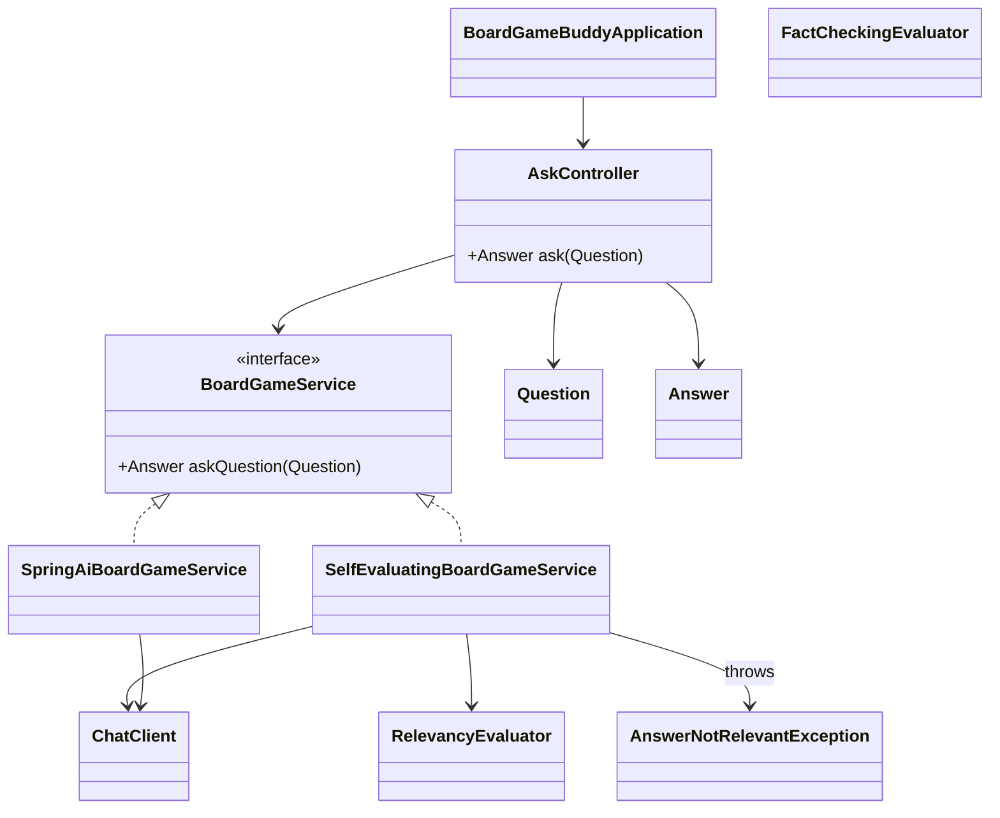

# Board Game Buddy - Spring AI

Implementasi praktikum Spring AI Chapter 1 dan Chapter 2 menggunakan Spring Boot dan OpenAI.

## Persyaratan

- JDK 17
- Gradle Wrapper
- API key OpenAI untuk evaluasi dan demo live

## Konfigurasi

Jangan menyimpan API key dalam source code. Set environment variable:

```powershell
$env:SPRING_AI_OPENAI_API_KEY="isi-api-key-anda"
```

Konfigurasi model default di `src/main/resources/application.properties`:

```properties
spring.ai.openai.chat.options.model=gpt-4o-mini
```

## Menjalankan

```powershell
.\gradlew.bat bootRun
```

Kirim pertanyaan melalui endpoint:

```powershell
Invoke-RestMethod -Method Post -Uri "http://localhost:8080/ask" `
  -ContentType "application/json" `
  -Body '{"question":"Why is the sky blue?"}'
```

## Pengujian

```powershell
.\gradlew.bat test
```

Suite mencakup:

- `contextLoads`
- test respons deterministik melalui `MockWebServer`
- evaluasi relevansi dan factual accuracy bila `SPRING_AI_OPENAI_API_KEY` tersedia

## UML Class Diagram


